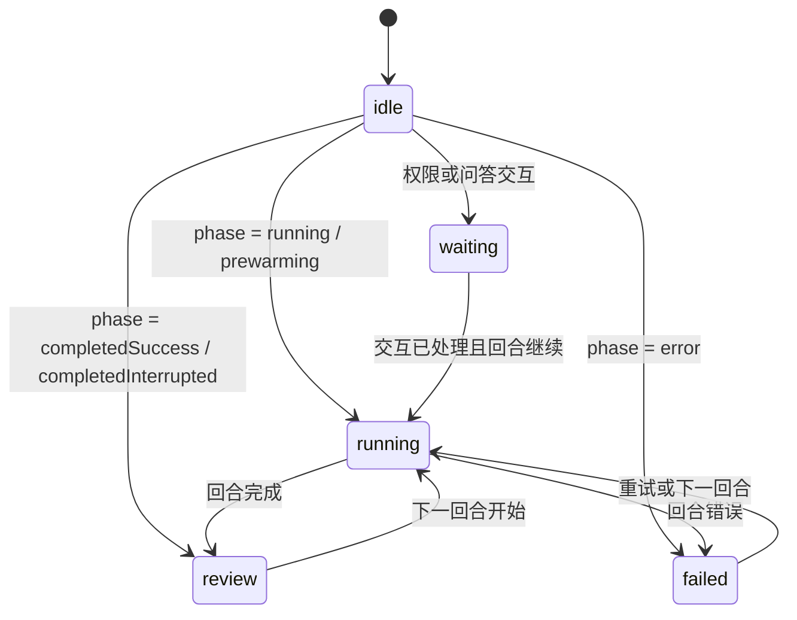

# 宠物伙伴（Codex 宠物系统复刻）

## 范围

在对话输入区上方显示一只环境宠物。宠物系统复刻 Codex TUI 的宠物行为与文件格式，
包含内置目录、Codex 自定义宠物目录、动画状态机、任务卡生命周期、选择器与扩展接口。

不包含：终端图片协议（Kitty / Sixel）、Codex 的 `/pets` 斜杠命令。桌面与 Web
使用同一套 DOM 渲染，覆盖 Desktop、Web 和手机远控。

## Codex 格式兼容

宠物目录结构：

```text
~/.codex/pets/<folder>/pet.json
~/.codex/pets/<folder>/spritesheet.webp
~/.codex/avatars/<folder>/avatar.json     # 旧版目录，兼容读取
~/.zcode/pets/<folder>/pet.json           # 本项目扩展目录
```

`pet.json` / `avatar.json` 字段：

| 字段 | 说明 |
| --- | --- |
| `id` | 可选；缺省时使用目录名 |
| `displayName` | 可选；缺省时依次回退 `id`、目录名 |
| `description` | 可选说明 |
| `spritesheetPath` | 可选；默认 `spritesheet.webp`，只允许宠物目录内的相对路径 |
| `frame` | 可选；默认 `{ width: 192, height: 208, columns: 8, rows: 9 }` |
| `animations` | 可选；同名覆盖默认动画 |

精灵表固定为 1536 × 1872，帧网格必须恰好覆盖整张图。默认动画行：

| 行 | 动画 | 帧数 |
| --- | --- | --- |
| 0 | `idle` | 6 |
| 1 | `running-right` | 8 |
| 2 | `running-left` | 8 |
| 3 | `waving` | 4 |
| 4 | `jumping` | 5 |
| 5 | `failed` | 8 |
| 6 | `waiting` | 6 |
| 7 | `running` | 6 |
| 8 | `review` | 6 |

状态动画连续播放三遍后进入 `idle` 循环；`idle` 使用 Codex 自带的逐帧时长。
自定义动画支持 `frames`、`fps`（默认 8，上限 60）、`loop`（默认 true）与
`fallback`（默认 `idle`）。

## 数据来源与优先级

1. 内置目录：Codex 的 8 个内置宠物，精灵表在运行时从官方 CDN
   `https://persistent.oaistatic.com/codex/pets/v1/` 获取，不随仓库分发。
2. Codex 自定义宠物：按 `avatars` → `pets` → `.zcode/pets` 顺序扫描，同名目录后扫描者生效。
3. 第三方 provider：`registerPetProvider()` 注册后合并，同 id 后注册者生效。

首次启动且用户从未保存过宠物选择时，若 `~/.codex/pets` 中存在自定义宠物，
自动选中第一只，便于从 Codex 无缝迁移。用户主动选择（包括 `disabled`）后不再改写。

## 状态机



状态动画由任务卡列表派生，优先级为 waiting > failed > running > review > idle；
任一任务等待输入时优先显示 waiting，全部任务都没有活动时回到 idle。

## 任务卡

宠物窗口显示当前焦点 workspace 的任务卡列表，最多 3 条，按最近活动时间降序：

| 条件 | 卡片状态 | 图标 | 小字缺省 |
| --- | --- | --- | --- |
| `running` / `prewarming` | running | 无 | 正在思考 |
| 存在权限或问答交互 | waiting | 无 | 需要输入 |
| `error` | failed | 红色叉号 | 已阻塞 |
| `completedSuccess` / `completedInterrupted` | review | 绿色对勾 | 已完成 |

- 标题取会话标题，空时回退“新任务”。
- 小字优先显示最后一条助手正文首行（最多 80 字）；焦点会话取当前 turn 最后一条
  `userInput` 之后的正文，其它会话取 sessions-index 的 `lastAssistantPreview`。
  sessions-index 对流式正文按 250ms 窗口合并发布，运行中的后台会话也能跟到当前输出。
- 数据来自焦点 workspace 的 sessions-index，与侧栏共用同一条订阅；焦点会话的
  phase 与流式正文再由当前 conversation snapshot 覆盖。
- 已归档会话不出卡：归档只改变组织态，不会从 sessions-index 删除摘要，因此由主窗口
  按项目树的 `archived` 标记过滤。
- 显示窗口：running / waiting 持续显示；failed 1 小时；review 10 分钟。
- 点击任务条会恢复主窗口并切到对应会话。点击 review / failed 卡片还会立即从宠物窗口
  移除该条，不必等过期；同一会话开始下一轮后新的任务卡会重新出现。
- 同时存在 2 条以上任务卡时，卡片栈右上角显示折叠开关；折叠后只保留任务数量与展开入口。
- draft 会话不出卡；`workspaceHookReview` 软审核不算 waiting。

## 交互动画

- 鼠标移入宠物：优先播放宠物自定义的 `hover` 动画，没有则播放 `jumping`
  一次；移出立即恢复当前状态动画。
- 发送消息（任务进入 running）：播放 `waving` 一次。
- 任务完成（running → review）：播放 `jumping` 一次，之后回到 review 循环。
- 拖动、动画开关与 `prefers-reduced-motion` 规则保持不变。

## 独立桌面窗口

宠物始终以一个独立的桌面悬浮窗出现，不嵌在对话输入框里：

- 透明、无边框、始终置顶、不进入任务栏；窗口不获取焦点（`WS_EX_NOACTIVATE`），
  拖动或点击宠物不会激活 LiefCode，也不会在 Dock/Alt+Tab 出现图标。
- 窗口按宠物大小与任务卡自动收缩/展开，保持右下角锚点；空闲时只占宠物本身的尺寸。
- 按住宠物拖动即可在桌面任意位置移动；拖动时按方向播放 `running-left` / `running-right`，
  松手回到 `idle` 或当前状态动画。松手后窗口整体回到当前显示器工作区内，位置写入
  `userData/desktop-pet-window.json`，下次启动沿用。
- 单击宠物恢复并聚焦主窗口；单击任务条在恢复主窗口的同时切到对应会话。
  主窗口被销毁时重新创建。主窗口会短暂置顶把窗口带到最前。
- 任务条跳转复用系统任务通知的 `taskId` 通道：Main 只转发 ID，renderer 负责按
  workspace 反查并切换任务，不新增第二套会话导航状态。
- 右键宠物打开原生菜单：`打开 LiefCode` / `退出 LiefCode`。
- 关闭最后一个主窗口时，如果桌面宠物处于启用状态，应用改为隐藏窗口并继续在后台运行，
  由宠物承担状态汇报和重新打开入口；托盘或宠物右键菜单仍可退出。
- Windows 在移动/缩放透明置顶窗口后会丢失 `WS_EX_TOPMOST`；主进程每秒重申置顶，
  窗口层级使用 `screen-saver`，高于任务栏与无边框全屏应用。拖动过程中只移动窗口，
  不逐帧重申层级，松手时再重申一次。
- 拖动期间渲染进程按动画帧合并指针事件，主进程也把排队的移动请求合并成一次窗口定位；
  松手时以当前光标位置校正窗口，避免高频原生移动导致窗口卡顿。

主进程只转发展示数据，不解析会话或持有任务状态。主窗口中的焦点 pane 通过
`PetDesktopStatusPublisher` 把宠物定义、状态、主题与本地化任务卡发给 Main，
Main 再转发给宠物窗口。

## 渲染与布局

- 宠物显示高度由设置中的“宠物大小”决定（96–256px，默认 160px）；窗口宽度取
  宠物宽度与任务卡宽度（248px）的较大值。
- 关闭动画或系统 `prefers-reduced-motion` 时固定在当前动画首帧。
- 任务卡在宠物上方纵向堆叠，保持窗口右下角锚点，避免出现卡片时宠物在屏幕上跳位。
- 每张卡片显示标题、状态小字与完成/错误图标；卡片带 `expiresAt`，即使主窗口被
  系统节流，宠物窗口也会按时移除过期卡片并回到 idle。
- 折叠状态由宠物窗口本地持有，不写回主窗口；主窗口只下发已本地化的折叠/展开名称。

## 设置与同步

外观设置新增“宠物伙伴”分区：显示开关、动画开关、宠物大小、桌面常驻、位置重置、
选择器与刷新按钮。选择结果保存在本机 localStorage，并登记到跨窗口广播字段：

- `petId`
- `petAnimationsEnabled`
- `petDesktopEnabled`
- `petSizePx`

广播接收端直接调用切片 setter，写入 localStorage 后更新 store；本窗口回声由
`applyingBroadcast` 屏蔽。

## 扩展接口

```ts
import {
  parseCodexPetManifest,
  registerPetProvider,
  type PetProvider,
} from "@zcode/ui";

const provider: PetProvider = {
  id: "my-pets",
  async list() {
    return [/* PetDefinition[] */];
  },
};
const unregister = registerPetProvider(provider);
```

可复用的纯函数：`parseCodexPetManifest`、`buildDefaultPetAnimations`、
`resolvePetFrame`、`resolveActivePetAnimation`、`petAnimationDurationMs`。
组件扩展点：`<DesktopPetView>`（桌面宠物窗口展示层）、`<PetDesktopStatusPublisher>`、
`<PetSettingsSection />`。

## 验收

- 单元测试覆盖：默认清单、帧网格校验、路径越界、动画 fps / loop / fallback、
  循环与一次性帧选择、任务卡映射与过滤排序、流式正文选择、provider 合并、
  桌面窗口显隐/拖动/位置持久化/关闭驻留。
- `pnpm typecheck`、`pnpm lint`、`pnpm architecture:check --changed` 必须通过。
- 桌面端手工验证：选择 `~/.codex/pets/beibeimao` 后，宠物以独立置顶窗口出现；
  拖动时播放方向动画，窗口按宠物大小/任务卡自适应；点击宠物恢复主窗口；
  最小化/关闭主窗口后宠物仍在；运行、等待权限、完成、错误四种状态分别播放对应
  动画并显示任务卡；同时运行多个任务时最多显示 3 张卡片，可折叠卡片栈；点击任务条
  切到对应会话，点击已完成/失败卡片后该条消失，归档会话不再出卡；完成显示绿色对勾、
  错误显示红色叉号；鼠标移入播放反应动画，发送与完成各触发一次动画。
